# TeXPro

**一个把 Typora 的「纸面感」和 TeXstudio 的「工程闭环」接起来的可见即可得 LaTeX 工作台。**

TeXPro 不是 Markdown 编辑器，也不是把 PDF 截图贴到编辑器里的伪预览。你编辑的始终是普通 `.tex`：公式、标题、表格、图片、TikZ 和引用在源码上就地呈现；点击任意渲染对象就回到对应 LaTeX 源码。PDF 预览可按需展开，`latexmk` 编译，SyncTeX 双向跳转。

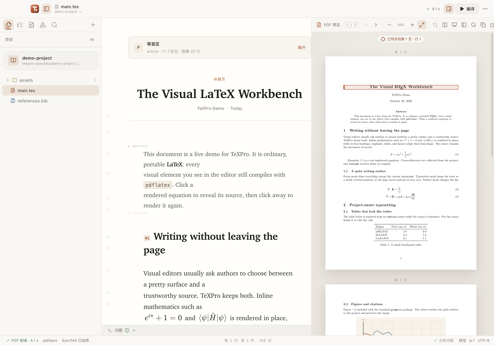

> 默认视觉参考 Typora：浅色纸面、单列写作区、克制的 chrome；工具栏收进右上角「更多」菜单。需要并排看 PDF 时，点标题栏的 PDF 按钮。

---

## 为什么是它

| 你熟悉的痛点 | TeXPro 的做法 |
| --- | --- |
| TeXstudio 很强大，但写作时像在终端里排版 | 公式、标题、表格、图片在纸面上就地呈现，源码一键可回 |
| Typora 很沉浸，但它不是 LaTeX IDE | 原生 `.tex`、`latexmk`、多引擎、日志诊断、SyncTeX、项目树 |
| 公式预览要开浮窗/工具提示 | KaTeX 直接嵌在行内和块级源码里 |
| 编译完还要自己找 PDF 位置 | 光标停稳自动前向搜索；PDF 里 ⌘-click 反向跳回源码 |
| 表格/图片源码难以想象最终效果 | `tabular`、`includegraphics`、caption、label 都有视觉投影 |
| 大项目找不到结构 | Outline、项目搜索、label/citation 补全、Preamble 折叠 |

### 应用图标

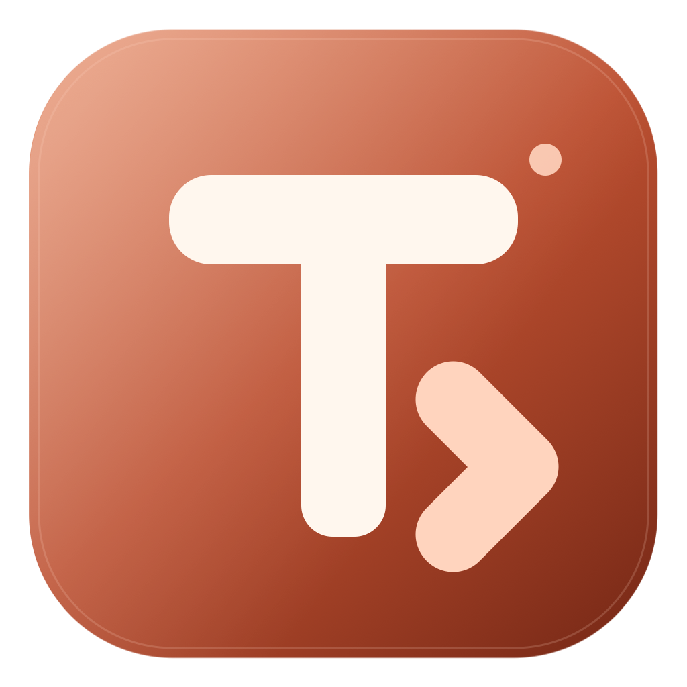

- 同一个图标用于 Dock、窗口、favicon、应用内 Logo 和打包产物
- `build/icon.svg` 是源文件；`icon.png` / `icon.icns` 由它生成
- macOS 打包使用 `build/icon.icns`，开发时通过 `app.dock.setIcon` 显示

### 视觉编辑

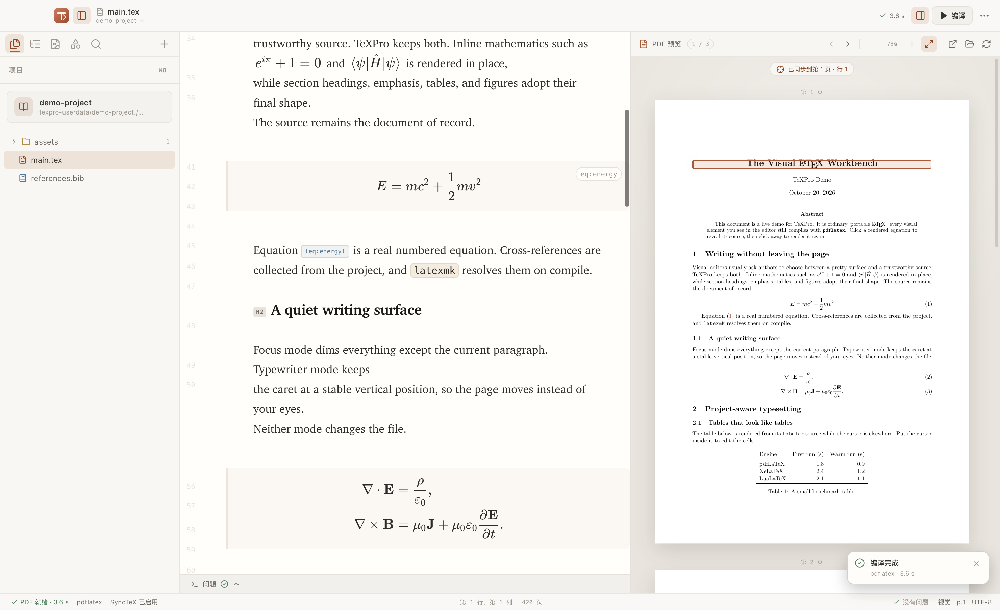

- 行内 `$...$` / `\(...\)` → KaTeX
- `$$...$$`、`\[...\]`、`equation`、`align`、`gather`、`multline` → 块级 KaTeX
- `\section` / `\subsection` → 标题 + 级别 badge
- `\textbf` / `\textit` / `\emph` / `\texttt` / `\underline` / `\textsc` → 真实样式
- `\includegraphics` → 图片预览（相对路径按当前 `.tex` 解析）
- `tabular` / `tabularx` / `longtable` → 表格预览
- `\label`、`\ref`、`\eqref`、`\cite` → 可点击的语义 pill
- `abstract`、`figure`、`table`、列表等环境 → 紧凑环境标记，而不是一行行裸命令
- Preamble → 一张「文档类 · 包数量 · 隐藏行数」卡片，点击展开

光标进入任意对象时，视觉层立即让位给源码；光标离开后重新渲染。

### 工程与编译

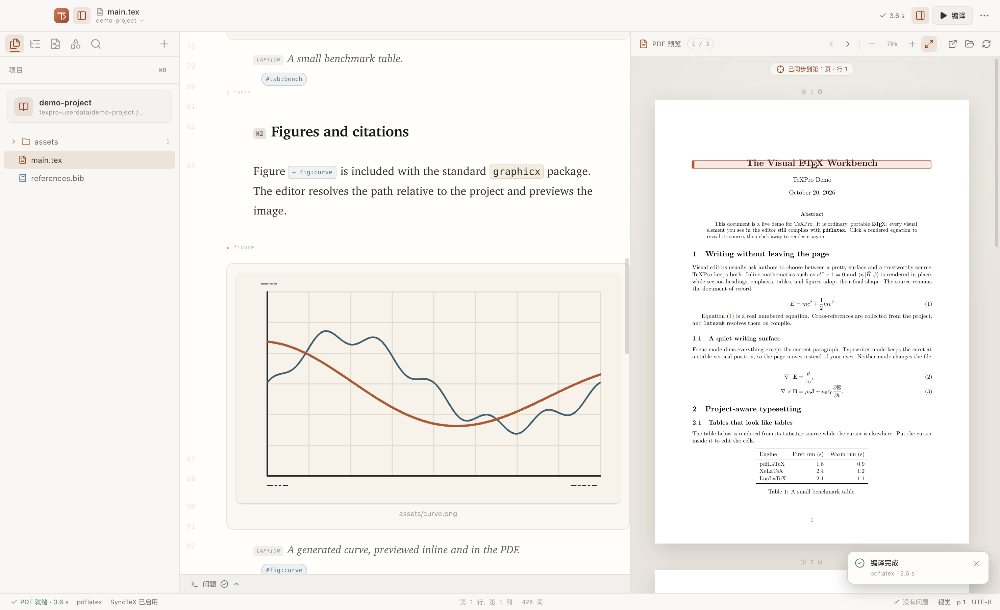

- 打开文件夹作为工程；只有一个包含 `\documentclass` 的候选时自动识别，多个候选时在侧栏明确选择主文件
- 主文件固定在 `.texpro/project.json` 的 `rootFile`；编辑标签及子文件的 `% !TeX root` 不会覆盖工程入口；支持 `% !TeX program = ...` 选择引擎
- `latexmk` 构建，支持 pdfLaTeX / XeLaTeX / LuaLaTeX
- 编译前保存所有已修改文件，输出到 `<project>/.texpro/build/`，可通过工程配置的 `directories.build` 修改
- 标题栏与侧栏同时显示主文件；结构、版式、宏包、MCP 和工具链动作共用同一入口
- 编译日志流式显示；解析错误、警告、Overfull/Underfull
- 点击 Problems 条目跳到对应文件/行；CodeMirror lint gutter 标记
- 自动保存、自动编译（默认开启，2.2 秒防抖）
- 编译可随时取消：标题栏编译按钮在构建中变为「取消」，主进程终止整个 latexmk 进程组
- 文件树、当前文件 Outline、跨项目搜索、项目符号索引
- `\ref{` / `\cite{` / `\begin{` / `\usepackage{` / `\includegraphics{` 项目感知补全
- 补全列表沿用 Paper / Night / Studio 的面板、字体和柔和选中态；方向键选择、Enter 插入、Esc 关闭

### 模板与多语种排版

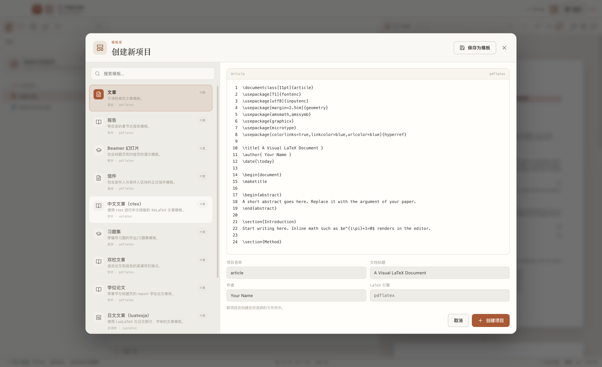

- 内置文章、报告、双栏论文、学位论文、Beamer、信件、习题集、中文 ctex、日文 luatexja、阿拉伯文 polyglossia、俄文 polyglossia 模板
- 中文模板使用 `ctexart` + XeLaTeX，带 2em 首行缩进、`\ctexset` 标题层级和 `indentfirst`
- 日文模板使用 `ltjsarticle` + LuaLaTeX；阿拉伯文使用 `Al Nile` + RTL；俄文使用 `Arial` + polyglossia
- 模板会保留 `{{title}}` / `{{author}}` 占位符，创建前填入标题、作者和项目名
- 当前文档可保存为个人模板，持久化在应用数据目录；模板可删除、搜索、预览源码
- 编译引擎会从 magic comment、`ctex` / `luatexja` / `polyglossia` / `fontspec` 等包自动判断

### 从 Markdown / Typst 导入

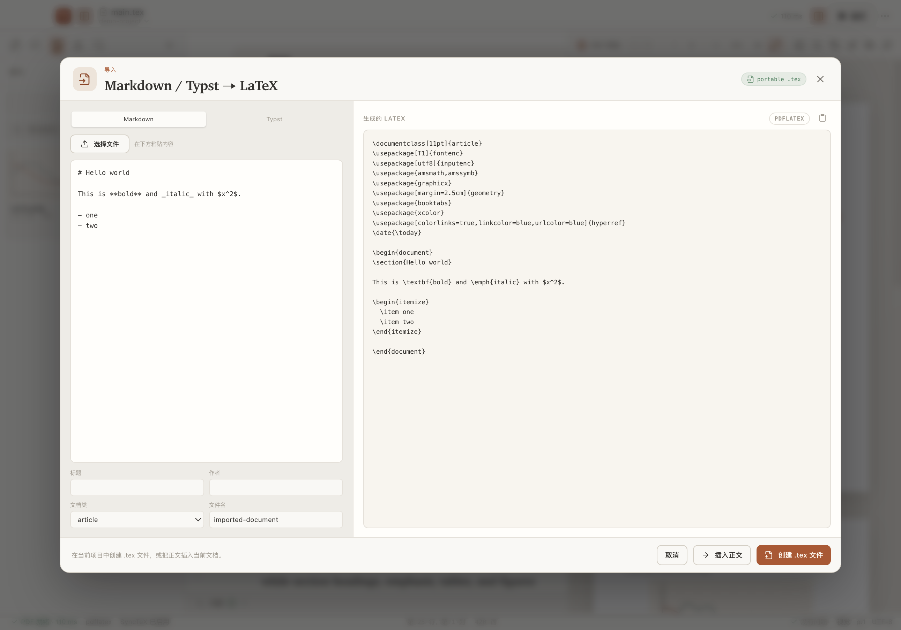

- Markdown：标题、段落、粗体/斜体、行内/块级公式、列表、引用、代码块、表格、链接、图片
- Typst：`= 标题`、列表、`*粗体*` / `_斜体_`、`$公式$`、`#link`、`#image`、`#figure`、`#set document(title/author)`
- 文件选择或直接粘贴；实时生成完整可编译 `.tex`
- 支持 article / ctexart；检测中文自动切 XeLaTeX
- 可把正文插入当前文档，或在项目内创建新 `.tex` 文件
- 不支持的 Typst 函数/复杂 Markdown 会在面板中列出 warning，不静默丢失

### 模板设计工坊

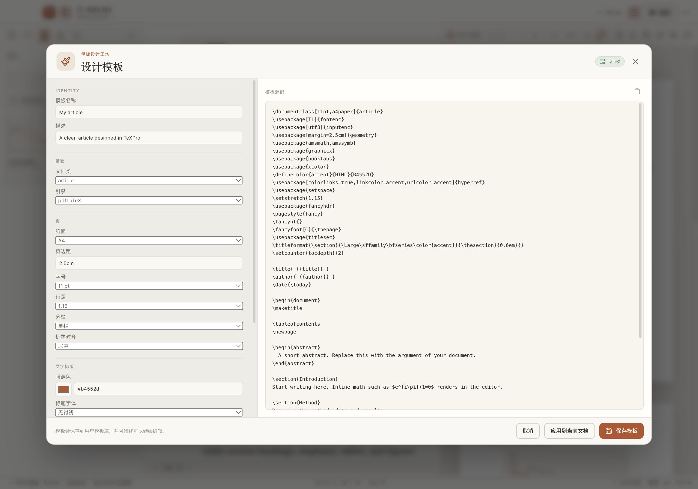

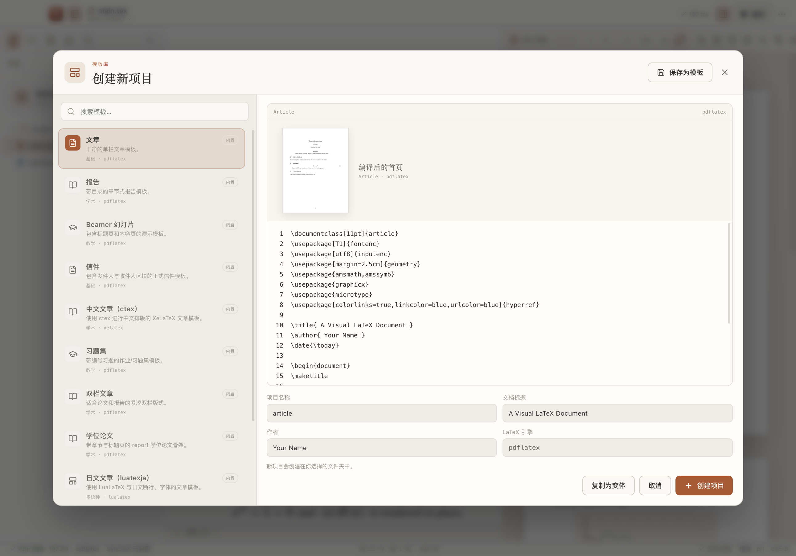

- 选择 article / report / ctexart / beamer 基础类
- 页面：纸张、页边距、字号、行距、单双栏、标题对齐
- 字体排印：强调色、标题无衬线/衬线、页眉
- 结构：目录、摘要、页码
- 宏包：amsmath、graphicx、booktabs、tikz、pgfplots、hyperref
- 实时生成完整 LaTeX 源码；保存后进入用户模板库，可继续编辑或直接用来创建项目
- 模板库显示编译后的真实首页缩略图；支持“复制为变体”做继承
- 生成的 article / report / ctex / beamer 模板已通过本机 latexmk 编译验证

### 素材库

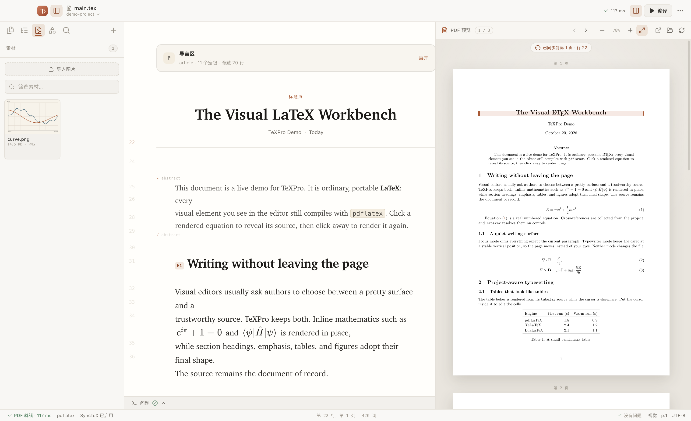

- 扫描项目中的 PNG / JPG / WebP / GIF / SVG / PDF / EPS 素材
- 缩略图预览、导入、筛选、复制相对路径、在访达中显示、删除
- 点击缩略图进入图片/PDF/音视频/未知格式预览；悬停操作可插入 `\includegraphics`
- 相对路径按当前 `.tex` 计算；PDF 用内嵌查看器，未知格式提供系统打开
- 与项目树共享同一份磁盘内容，不建立私有媒体数据库

### 符号库

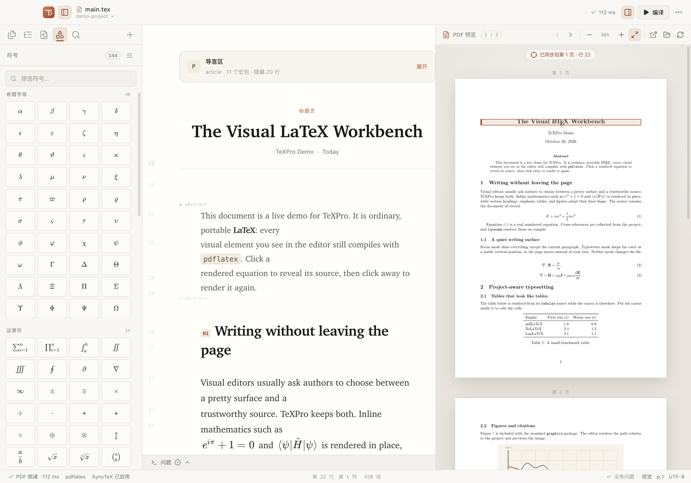

- 所有符号用 **KaTeX 真实渲染**，不再只显示 `alpha` / `beta` 名字
- 模块化目录：希腊字母、运算符、关系符、集合与逻辑、箭头、定界符、重音、结构
- 每个模块可单独启用/禁用，配置保存在本地；支持搜索、最近使用
- 点击符号插入到光标处；在公式 AST 模式下会作为结构化节点插入
- 与公式编辑器共用同一份 `symbolModules` 目录，避免两套符号定义

### 公式编辑器：代码 + AST

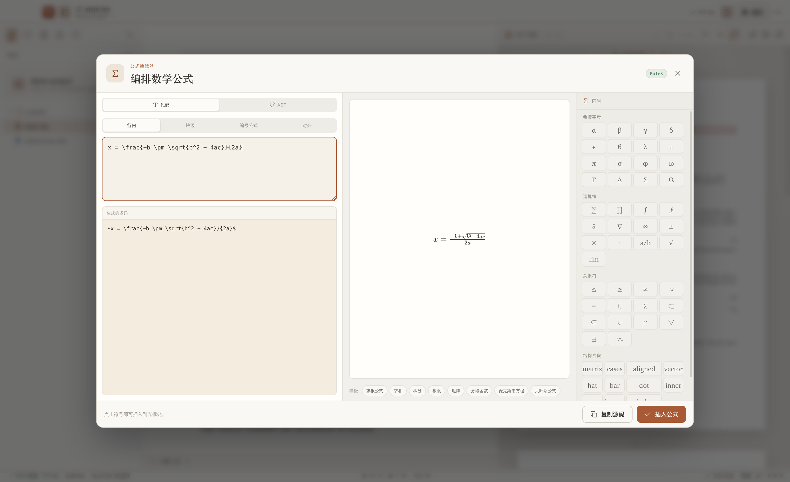

- **Code 模式**：直接输入 LaTeX 数学源码，KaTeX 实时预览
- **AST 模式**：把公式解析成树，节点可增删改；支持 row / symbol / text / frac / sqrt / scripts / matrix / cases
- 两种模式双向同步：切到 AST 时解析当前代码，切回 Code 时序列化当前树
- 行内 / 块级 / 编号公式 / align 四种插入模式
- 右侧符号库点击后，Code 模式插入命令，AST 模式插入结构化节点
- 语法错误实时反馈；最近使用公式保存在本地
- 可自动生成 `\label{eq:...}`，插入后仍是纯源码

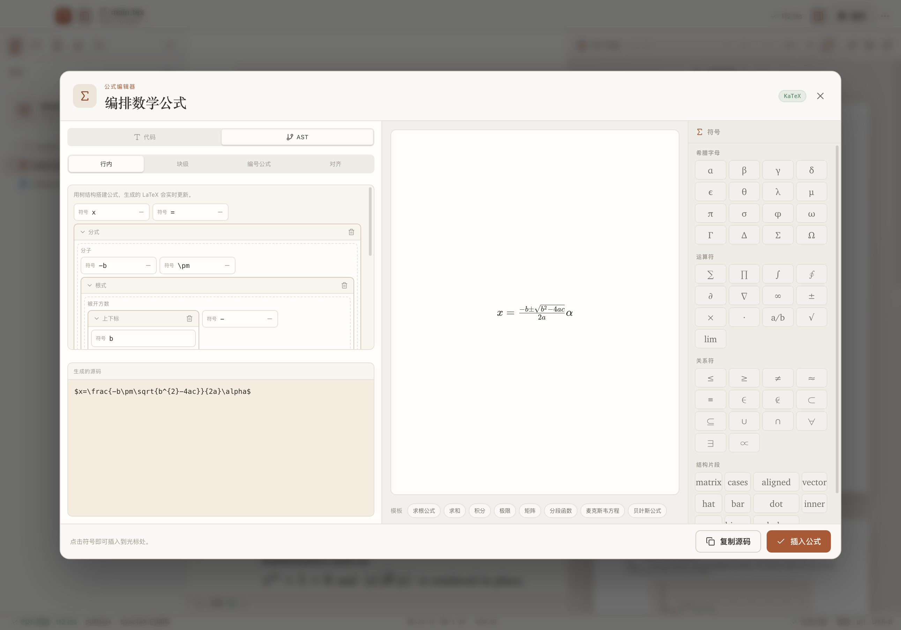

### 结构化项目：目录、模块与 TOC

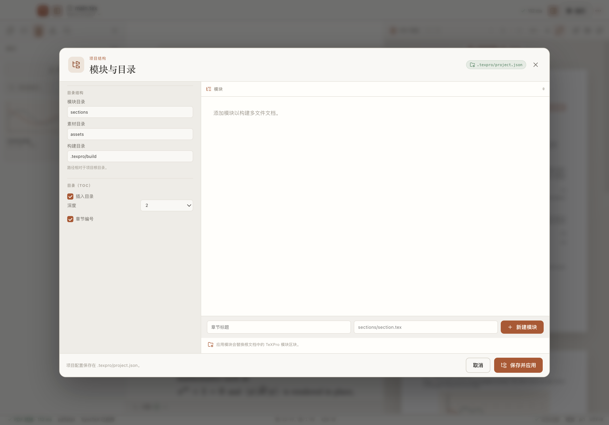

- 项目配置持久化在 `.texpro/project.json`
- 可配置模块目录、素材目录、构建目录（构建目录会真正传给 latexmk）
- 自动发现项目内 `.tex` 模块；可新建模块、命名、排序、启用/停用
- 应用模块时在根文档写入 `% TeXPro modules begin/end` 区块，替换而不是堆叠
- 目录（TOC）配置：是否插入、深度 1–4、章节是否编号；插入到 `\maketitle` 之后
- 模块和 TOC 都是可编辑的 LaTeX，不是私有格式

### BibTeX 管理器

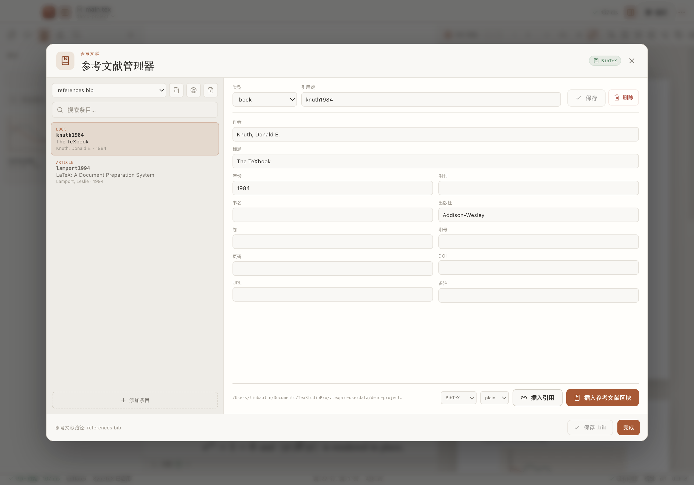

- 扫描项目内 `.bib` 文件，解析标准 BibTeX 条目
- 条目列表、搜索、新建/删除、字段编辑、保存
- 支持 article / book / inproceedings / thesis / misc 等常用类型
- 一键插入 `\cite{key}`；BibTeX / BibLaTeX 模式切换，支持 numeric / authoryear / apa 等样式
- DOI / arXiv 查询、RIS / EndNote 导入、重复 key 自动后缀
- 保存后刷新项目引用索引，补全立即生效
- 新建 `.bib` 文件、复制条目信息、查看文件路径

### 页面版式设计

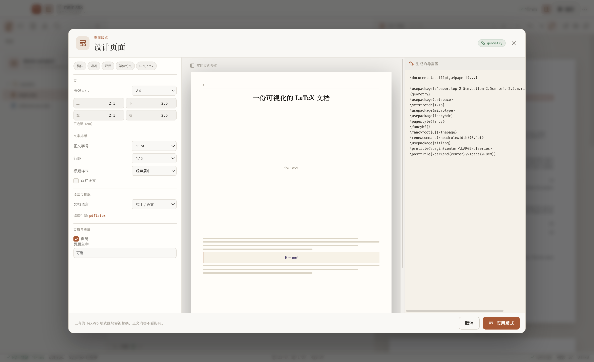

- 纸张 A4 / Letter / A5，四边独立页边距
- 10 / 11 / 12 pt 正文字号，1.0 / 1.15 / 1.5 / 2.0 行距
- 单栏 / 双栏、经典居中 / 极简左对齐标题
- 页眉文字、页码开关
- 语言档案：拉丁、中文 ctex、日文 luatexja、阿拉伯文 polyglossia、俄文 polyglossia；自动推荐编译引擎
- 版式以 `% TeXPro layout begin/end` 区块写入导言区，重复应用会替换旧区块，正文不受影响

### 原生 pgfplots 与 TikZ

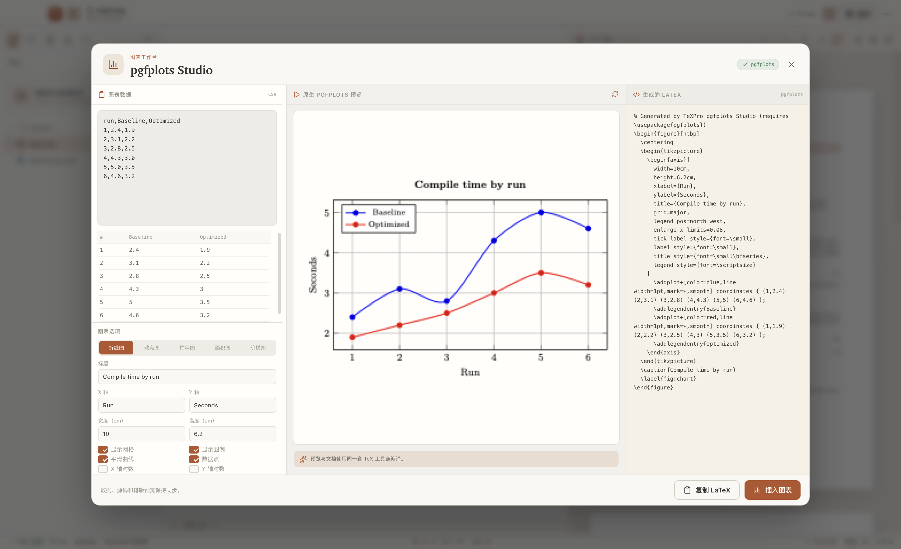

**图表不再使用 ECharts。** 数据、生成的 pgfplots 源码和排版预览是同一条 TeX 链路：

- CSV 数据 → 折线 / 散点 / 柱状 / 面积 / 阶梯图
- 标题、X/Y 轴、图例位置、网格、平滑、数据点、对数轴、宽高、额外 axis 选项
- 生成完整 `figure` + `tikzpicture` + `axis` + `addplot` 代码，可插入当前文档
- 预览使用当前文档导言区和本机 `pdflatex` / `xelatex` / `lualatex` 编译后栅格化，所见即所得
- 自动补 `\usepackage{pgfplots}` 和 `\pgfplotsset{compat=1.18}`

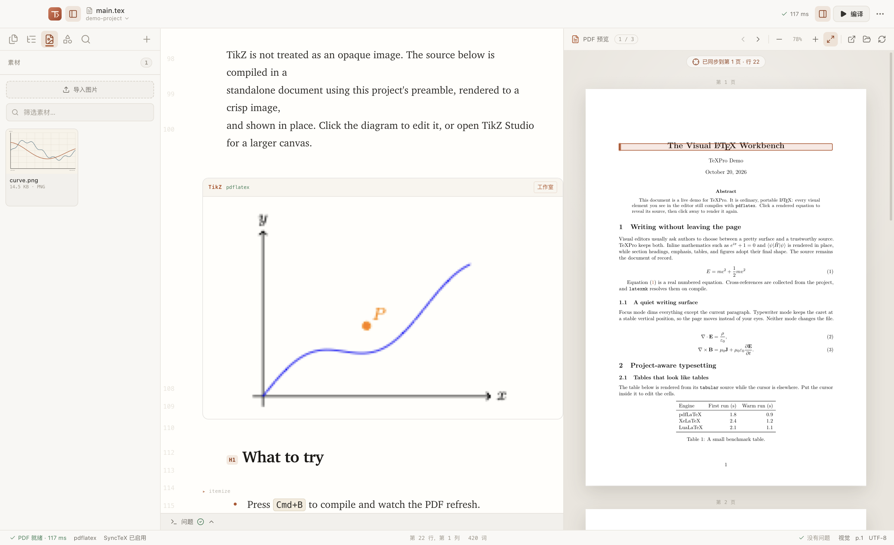

- `tikzpicture` 在编辑器内编译预览，而不是当作图片
- 复用当前文档导言区（颜色、`\usetikzlibrary`、自定义命令），带项目级缓存
- 渲染失败显示 TeX 日志；点击「工作室」打开 TikZ Studio
- TikZ Studio 提供函数图、流程图、几何图模板，代码 ↔ 预览 ↔ 插入联动

### PDF 与 SyncTeX

- PDF.js 连续页渲染，页码、缩放、适应宽度、打开/定位 PDF；默认收起，避免打断写作
- 编译成功后，光标停稳 → `synctex view` → 只在对应文字盒子离开视口时滚动；自动跟随直接定位，手动定位平滑滚动
- 同步横幅显示页码 + 源码行号；反向搜索后编辑器对应行会短暂高亮
- 在 PDF 页面 **⌘ / Ctrl-click** → `synctex edit` → 打开源文件，选中并短暂高亮对应源码行
- 点击 PDF 工具栏的框选按钮，或按住 **⌘ / Ctrl** 拖框：按区域内文字行取样，选中对应源码范围；Esc 退出。保留普通拖动选择/复制文本
- 定位盒子统一换算缩放、页面裁切和旋转坐标；重新编译同一文档保留 PDF 页码、缩放和滚动位置
- SyncTeX 定位精度取决于排版产生的映射，框选是源码行级范围；选区涉及多个文件时打开匹配最多的文件并提示
- 文字层可选择/复制；双页视图、演示模式、缩略图；与上次编译结果叠加 diff
- 可在设置中关闭「PDF follows cursor」
- 方向键按逻辑行前进，遇到公式/表格等视觉块不会整块跳过；视觉重建合并到下一帧，输入优先

### 写作模式

- **Focus mode**：只保留当前段落，其余淡出
- **Typewriter scrolling**：光标固定在视口垂直中心
- **Visual / Source**：同一文档的两种投影
- **Paper / Night / Studio** 三套主题；默认 Paper 浅色纸面，⌘⇧L 日夜切换；PDF 默认收起
- **中 / 英双语界面**，可在设置中即时切换；所有新增面板均双语
- **Command palette**：⌘K 搜索所有动作
- **Demo project**：首次打开即可编译的完整示例
- **Start 页**：最近项目、模板、Quick actions、上手三步，不再用产品营销页占满首屏

### 文件预览

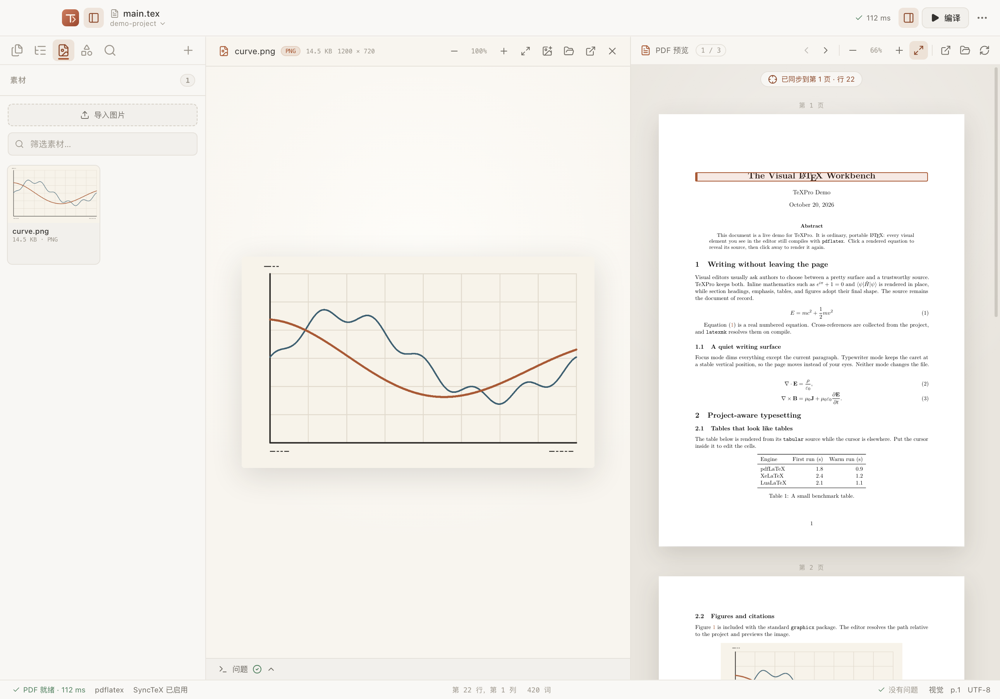

- 图片 / SVG：缩放、实际大小、尺寸、插入文档
- PDF：内嵌 Chromium PDF 查看器
- 音频 / 视频：原生播放器
- 文本 / 代码 / `.bib` / `.tex`：继续用编辑器打开
- 压缩包与未知格式：显示大小、修改时间、路径，提供系统打开/访达定位

| Welcome | Settings |
| --- | --- |
|  | 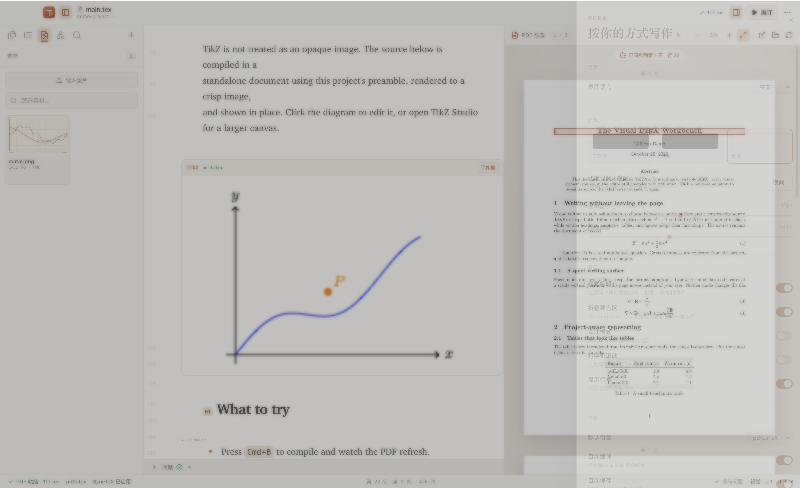 |
| **English UI** | **Command palette** |
| 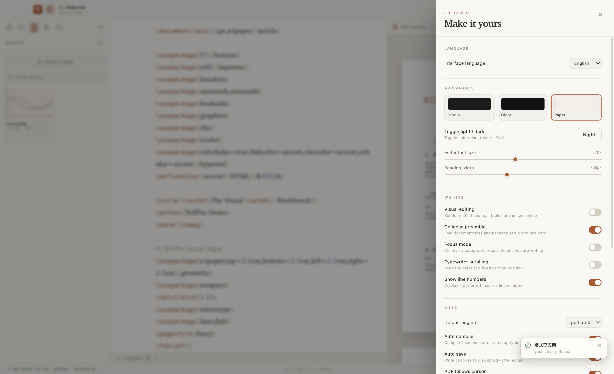 | 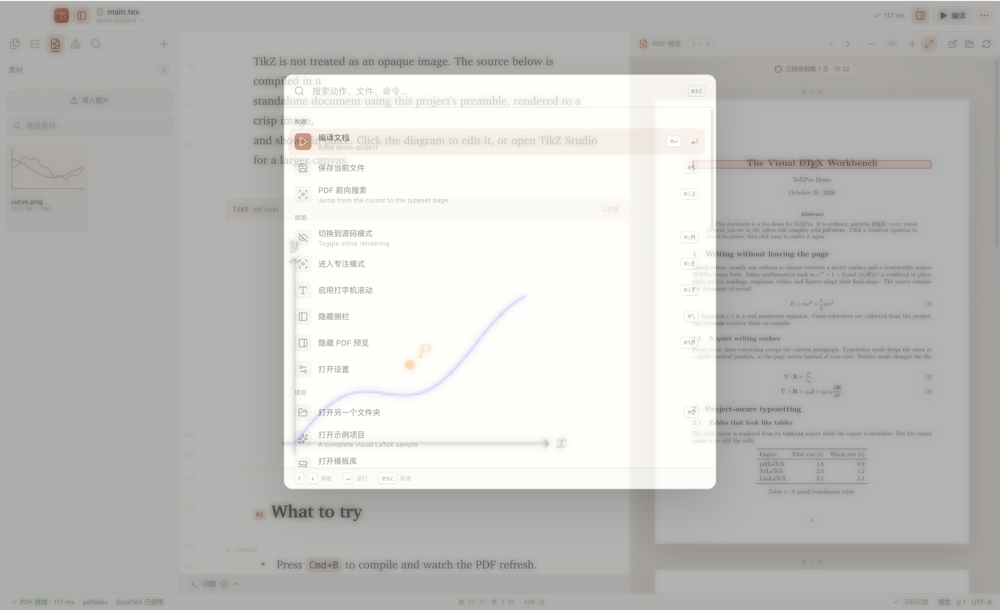 |

| Focus mode | Source mode |
| --- | --- |
| 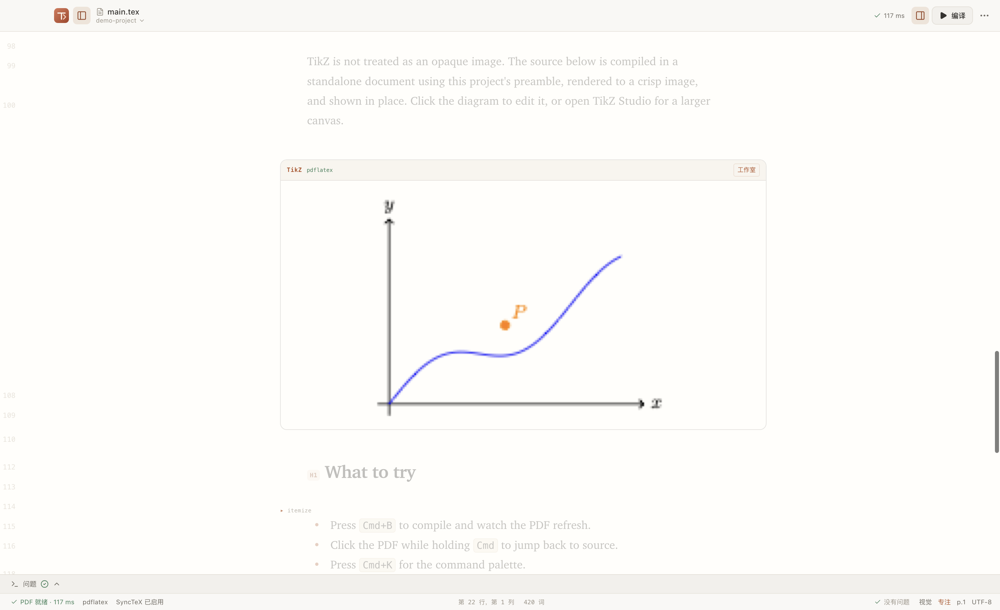 | 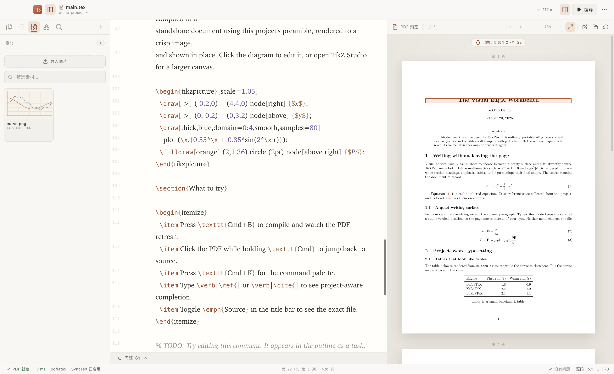 |

### 编辑与评审工作台

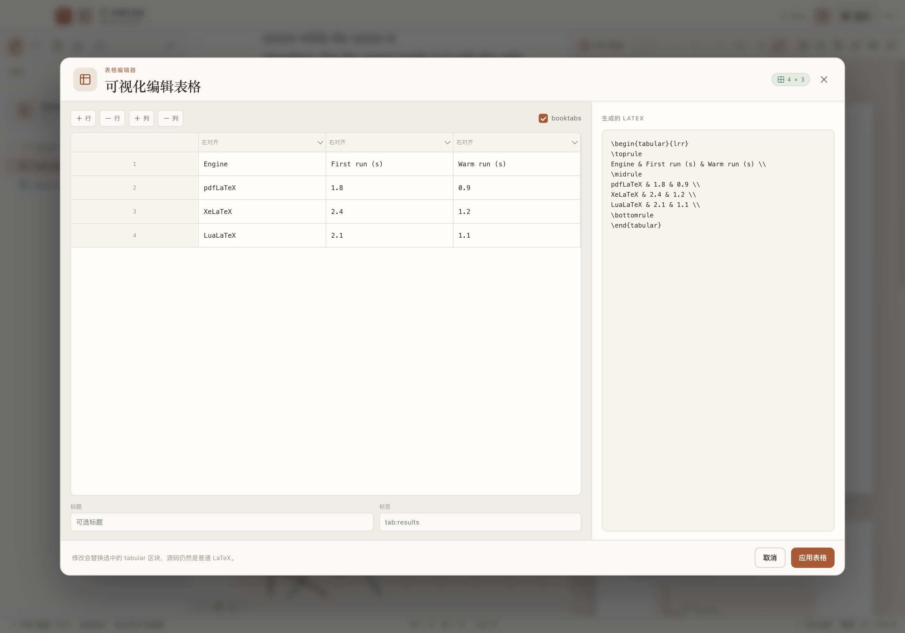

- 图片：编辑器内粘贴截图、从 Finder 拖入；自动写入素材目录并插入 `\includegraphics`
- 表格：点击 `tabular` 预览打开网格编辑器；增删行列、对齐、booktabs、caption/label
- 选区浮动工具条：粗体、斜体、等宽、行内公式、引用、引用跳转
- Hover：`\ref` / `\cite` / `\includegraphics` / `\usepackage` 显示上下文卡片
- 文件树右键重命名/目录移动，自动更新 `\input` / `\include` / `\includegraphics` / `\bibliography` 引用
- Project doctor 检测未被根文件引用的孤立 `.tex`


- Project doctor：检查 latexmk / XeLaTeX / LuaLaTeX / biber / SyncTeX / kpsewhich
- 缺包、断链、缺失图片、未定义引用、缺失文献 key、重复 label
- 一键清理构建目录

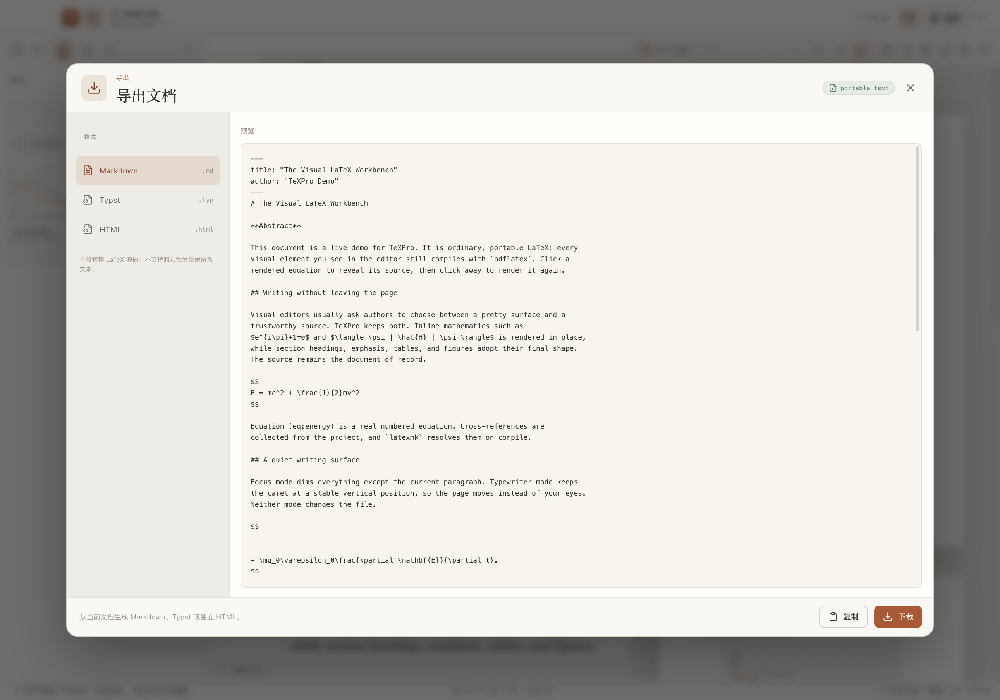

- LaTeX → Markdown / Typst / 独立 HTML
- 保留公式、列表、表格、图片、引用；支持复制和下载

### PDF 搜索、缩略图与评审

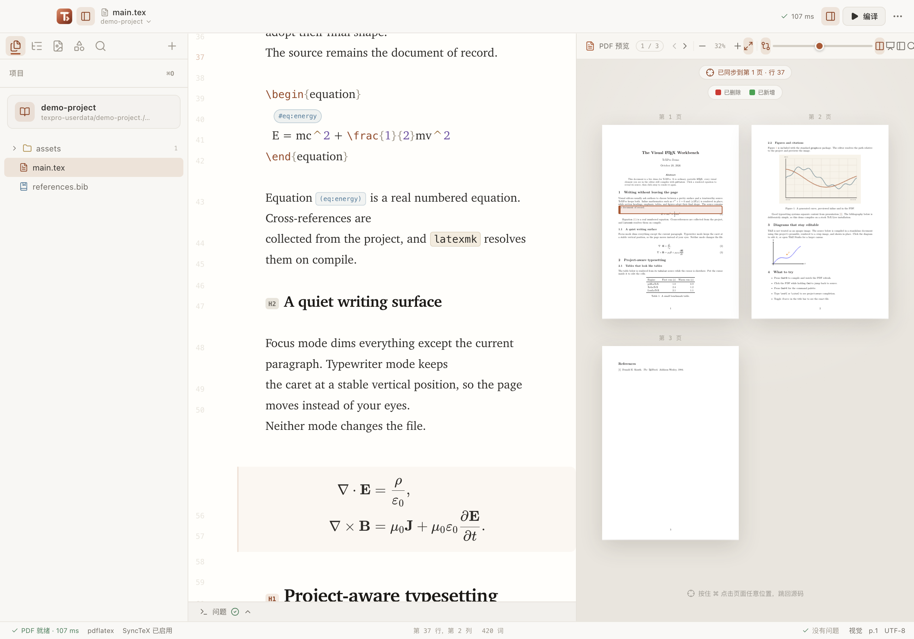

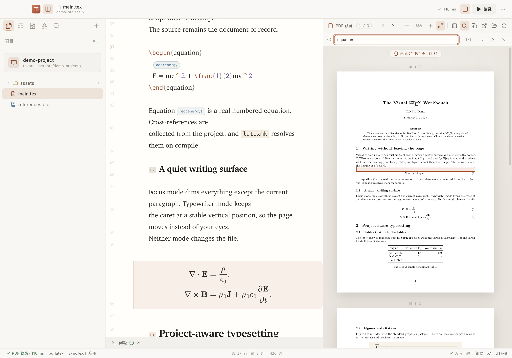

- PDF 文本搜索，结果计数，Enter / Shift-Enter 跳转
- 页面缩略图侧栏，按需渲染
- 复制当前页文本
- 页面懒渲染：只渲染视口附近的页面，离屏释放 canvas

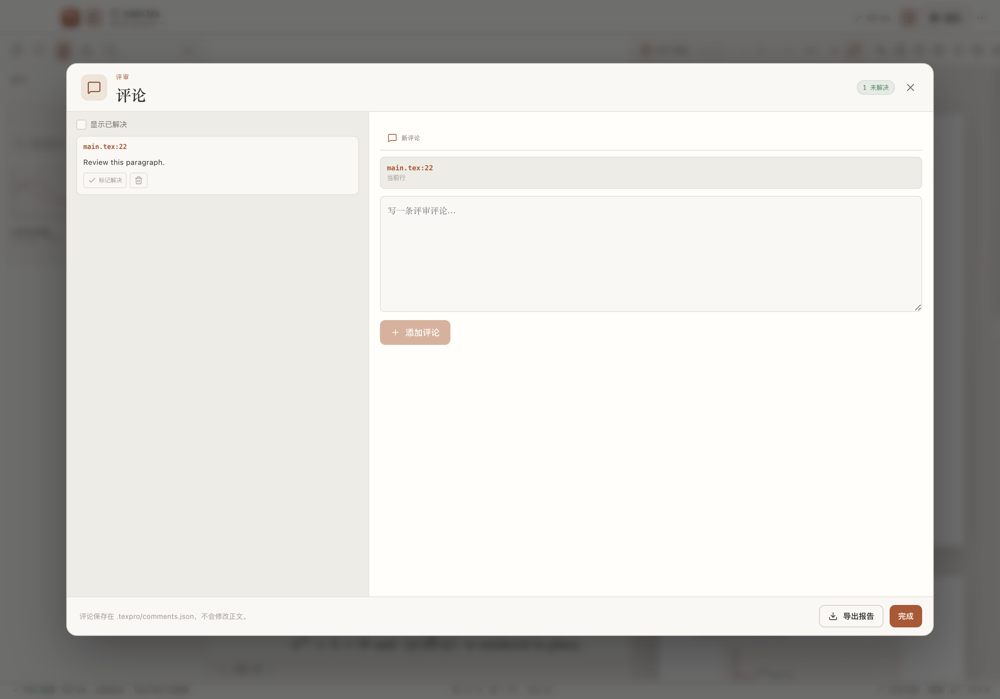

- 评论锚定到文件 + 行 + 源码片段，保存在 `.texpro/comments.json`
- 编辑/重命名后按源码片段自动重锚定；支持导出 Markdown 评审报告
- 解决 / 重开、跳回源码、删除；不修改正文

### 可选 AI 与编译策略


- 默认关闭；使用用户自己的 OpenAI 兼容端点和 API Key；流式输出、可随时停止
- 受控智能体操作：模型只返回 JSON 操作建议，用户逐条 Apply，不会自动改文档
- API Key 通过 Electron `safeStorage` 存入系统 Keychain，不写入 localStorage
- 解释编译错误、改写、中英翻译、根据描述生成 LaTeX
- 只有点击“运行”才会发送请求；Key 保存在本地设置
- 编译策略：手动 / 停止输入后 / 仅 PDF 打开时；编译任务自动排队、支持取消


---

## Nightly builds

`.github/workflows/nightly.yml` builds and publishes a prerelease automatically:

- Schedule: **03:17 UTC** daily (11:17 Asia/Shanghai), plus `workflow_dispatch`.
- Both triggers first check the **current calendar day in Asia/Shanghai**. Only commits with actual file changes on the checked-out branch count (committer time, first-parent history); empty commits do not. With no qualifying commit, tests, packaging and publication are skipped.
- macOS: universal DMG + ZIP, unsigned.
- Windows: NSIS installer + portable EXE + ZIP, x64.
- Ubuntu: `.deb` + AppImage, x64.
- CentOS / RHEL-compatible: `.rpm`, x64.
- Published under the fixed **`nightly`** prerelease tag; asset names include the nightly version and platform.
- The run first performs `npm run typecheck` and `npm run build`; packaging only starts if both pass.
- Only `main` can publish the nightly release.

Local equivalents:

```bash
node scripts/set-nightly-version.mjs
npm run package:mac
npm run package:win
npm run package:linux
```

Artifacts are written to `release/`. Nightlies are intentionally unsigned; macOS Gatekeeper and Windows SmartScreen will warn on first launch.

## 快速开始

### MCP server

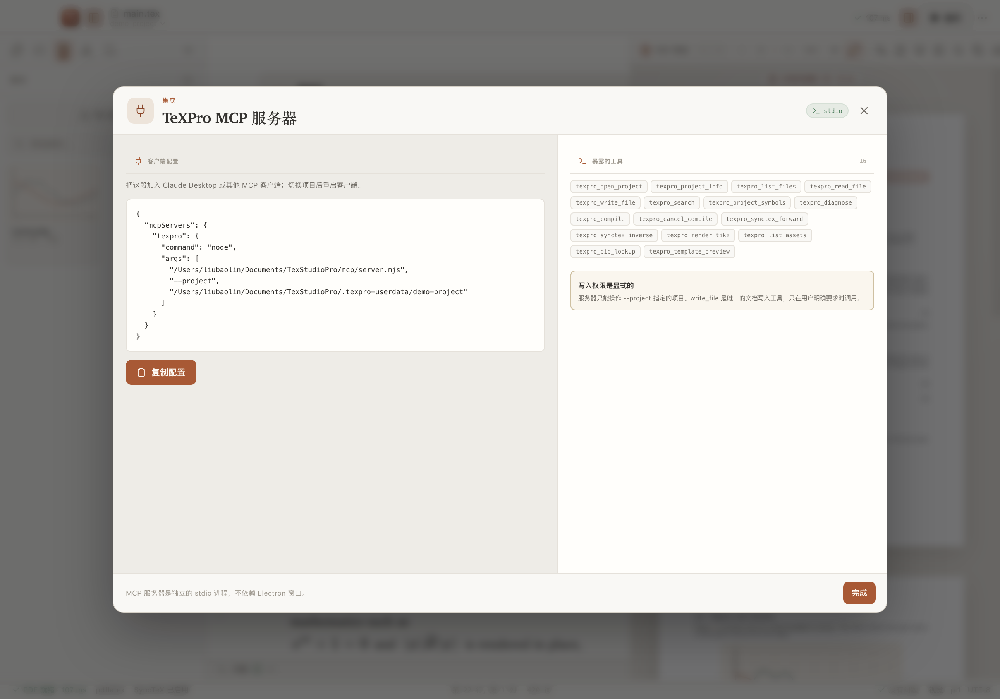

- 独立 stdio MCP server：不依赖 Electron 窗口
- 暴露 16 个工具：项目、文件、搜索、符号、编译、诊断、SyncTeX、TikZ、素材、Bib、模板预览
- 通过 `--project` 或 `TEXPRO_PROJECT_ROOT` 锁定项目；所有路径限制在项目内
- `write_file` 是唯一写文档工具，调用需要明确用户意图
- 设置面板可直接复制 Claude Desktop / MCP 客户端配置
- `npm run test:mcp` 对真实 stdio 协议做 initialize / tools/list / project / search / read / doctor 验证

完整配置见 [mcp/README.md](mcp/README.md)。

### 环境要求

- macOS（当前主要在 macOS 验证；代码是跨平台的）
- Node.js 22+（本项目在 Node 26 上构建）
- TeX Live（或 MacTeX）
  - `latexmk`
  - `synctex`
  - `pdflatex`，以及可选的 `xelatex` / `lualatex`

检查：

```bash
node -v
which latexmk synctex pdflatex
```

TeXPro 会自动把 `/Library/TeX/texbin` 等常见 TeX 路径加入编译子进程的 `PATH`；从 Finder/Spotlight 启动时也不需要手动配置 shell PATH。

### 安装与运行

```bash
npm install
npm run dev
```

`npm run dev` 会同时启动 Vite（127.0.0.1:5173）和 Electron。生产构建：

```bash
npm run build
npm start
```

首次启动会显示 Welcome；点击「打开示例项目」会在应用数据目录创建一个可写的 demo 项目，并自动编译一次。

> 如果 Electron 二进制没有被 npm 安装脚本下载（例如受限环境），可以手动执行：
>
> ```bash
> ELECTRON_CACHE="$PWD/.electron-cache" node node_modules/electron/install.js
> ```

### 打开已有项目

点击左上角项目名 / `⌘O`，选择一个包含 `.tex` 的文件夹。TeXPro 会：

1. 递归建立文件树（忽略 `.git`、`node_modules`、`.texpro` 等）
2. 优先使用 `.texpro/project.json` 的 `rootFile`；没有配置时，只接受唯一的 `\documentclass` 候选
3. 多个候选时提示选择；配置失效、文件丢失或内容不再包含 `\documentclass` 时提示错误，不自动换用另一篇文档
4. 打开主文件或在文件树中编辑章节，载入该主文件在配置构建目录中的 PDF（如果存在）

侧栏的「主文件」下拉框会把选择保存为相对路径，例如：

```json
{
  "rootFile": "paper.tex",
  "directories": { "build": ".texpro/build" }
}
```

选择会保留其他工程配置；重命名或移动主文件及其所在目录时更新路径。结构、版式和宏包设置会先打开主文件再应用。工具链动作的 `{rootFile}`、`{rootName}`、`{buildDir}` 在服务端根据当前工程配置解析；直接导出 Markdown/Typst/HTML 仍明确转换当前编辑文档。

点击左上角 Logo、更多菜单的「关闭工程并返回欢迎页」，或 `⌘⇧W` / `Ctrl+Shift+W`，可结束当前工程。关闭前保存所有修改；保存失败时保留工程。正在编译时会取消构建，延迟返回的 PDF 和同步结果不会重新打开工程。Welcome 保留最近工程，沿用 Paper / Night / Studio 主题，提供工程搜索、新建、打开和示例入口。

---

## 键盘

| 动作 | 快捷键 |
| --- | --- |
| 编译 | `⌘ ↩` |
| 保存 | `⌘ S` |
| 命令面板 | `⌘ K` |
| 打开项目 | `⌘ O` |
| 关闭工程并返回 Welcome | `⌘ ⇧ W` |
| 前向搜索 | `⌘ ⇧ J` |
| 视觉 / 源码 | `⌘ ⇧ M` |
| Focus mode | `⌘ ⇧ F` |
| Typewriter | `⌘ ⇧ T` |
| 切换 PDF | `⌘ ⌥ P` |
| 切换侧栏 | `⌘ \` |
| 日间 / 夜间 | `⌘ ⇧ L` |
| 粗体 / 斜体 | `⌘ B` / `⌘ I` |
| 打开设置 | 右上角「更多」菜单，或命令面板 |

PDF 反向搜索：**⌘-click**（Windows/Linux 为 Ctrl-click）。

---

## 架构

```text
┌─────────────────────────────────────────────────────────────┐
│ Renderer (React 19 + Vite)                                  │
│                                                             │
│  TitleBar / MoreMenu / Sidebar / Problems / StatusBar       │
│  CommandPalette / Settings / Welcome                        │
│  FormulaStudio + FormulaTree (Code / AST)                   │
│  LayoutStudio / PgfplotsStudio / TikzStudio                 │
│  TemplateGallery / BibManager / ProjectStudio / FilePreview │
│  ImportStudio / TemplateWorkshop / TableStudio              │
│  ProjectDoctor / ExportStudio / CommentsPanel / AIAssistant │
│                                                             │
│  CodeMirror 6                                               │
│   ├─ LaTeX StreamLanguage + syntax highlighting             │
│   ├─ StateField<DecorationSet>  ← 视觉投影（block widgets） │
│   │    ├─ KaTeX math widgets                                │
│   │    ├─ tabular table widget                              │
│   │    ├─ includegraphics image widget                      │
│   │    ├─ headings / emphasis / labels / refs               │
│   │    ├─ tikzpicture → project-cached raster preview       │
│   │    └─ preamble / title widgets                          │
│   ├─ project-aware autocomplete                             │
│   ├─ lint diagnostics                                       │
│   ├─ project modules / TOC transforms                       │
│   └─ focus / typewriter extensions                          │
│                                                             │
│  PDF.js viewer  ← PDF bytes                                 │
└───────────────────────────┬─────────────────────────────────┘
                            │ contextBridge (preload.cjs)
                            │ typed IPC, path allowlist
┌───────────────────────────▼─────────────────────────────────┐
│ Electron main (Node)                                        │
│                                                             │
│  project: walk tree, find root, read/write, search          │
│  tex:     latexmk (cancellable), diagnostics, SyncTeX       │
│  tikz:    standalone → pdf → high-res preview (cache)       │
│  project: templates, assets, config, project creation       │
│  file:    stat/read/write, project-scoped preview assets    │
│  shell:   open PDF / reveal in Finder / external links      │
└─────────────────────────────────────────────────────────────┘
```

### 目录

```text
electron/
  main.cjs                 # BrowserWindow, IPC, protocol, menu
  smoke.cjs / regression.cjs # isolated integration / UI checks
  preload.cjs              # contextBridge API
  services/tex.cjs         # project scan, latexmk, diagnostics, SyncTeX
  services/history.cjs     # local snapshots with Git boundary checks
  services/git.cjs         # Git and Overleaf operations
  services/project-files.cjs # shared file filters
  services/project-root.cjs # one main-file policy across the toolchain
src/
  App.tsx                  # state, project lifecycle, palette actions
  app/                     # settings, project helpers, deferred tools
  hooks/                   # preview lifecycle and dialog keyboard focus
  editor/
    EditorPane.tsx         # CodeMirror 6 instance + compartments
    visual.ts              # StateField decorations + widgets + focus/typewriter
    completions.ts         # commands, environments, labels, cites, images
    completionAppearance.ts # themed completion list and consistent icons
    latexLanguage.ts       # StreamLanguage
    theme.ts               # CodeMirror theme + widget CSS
  components/              # TitleBar, Sidebar, PdfPane, studios, BibManager...
  i18n.ts                  # zh/en dictionary + reactive language store
  lib/latex.ts             # outline, stats, path utilities, title parsing
  lib/templates.ts         # built-in multilingual project templates
  lib/importers.ts         # Markdown/Typst → LaTeX converters
  lib/exporters.ts         # LaTeX → Markdown/Typst/HTML
  lib/templateDesigner.ts  # template design → full LaTeX source
  lib/bib.ts               # BibTeX/RIS/EndNote parsing
  lib/ai.ts                # optional OpenAI-compatible client
  lib/symbols.ts           # modular KaTeX-rendered symbol catalog
  lib/formulaAst.ts        # formula AST, parser and LaTeX serializer
  lib/schematic.ts         # circuit, logic, structure models and LaTeX
  lib/bib.ts               # BibTeX parser/serializer
  lib/projectConfig.ts     # modules/directories/TOC config
  styles/app.css           # Paper/Night/Studio + native macOS materials
demo/                      # self-contained example project
scripts/
  test-compile.mjs         # compile + SyncTeX + diagnostics integration test
  test-ui.cjs              # real Electron gestures and autocomplete
  verify-release.cjs       # renderer entry assets and ASAR validation
  make-demo-image.mjs      # generates demo/assets/curve.png
mcp/
  server.mjs               # standalone stdio MCP server
  README.md                # client configuration and tool reference
build/
  icon.svg / icon.png / icon.icns
docs/
  architecture.md          # module boundaries and maintenance notes
  screenshots/
```

### 关键实现点

- **视觉层是 `StateField`，不是 `ViewPlugin`。** CodeMirror 允许 `ViewPlugin` 提供 inline decoration，但不允许 block decoration；因此 `visualLatex()` 返回一个 `StateField<DecorationSet>`，并在 `provide` 中映射为 `EditorView.decorations`。
- **输入优先，视觉合并到下一帧。** 文档/选区变化只把旧 decoration 映射到新文档，真正的重建通过 `requestAnimationFrame` 合并执行，避免每敲一个字都同步扫全文。焦点插件同样合并到下一帧。
- **方向键按逻辑行移动。** 默认光标会跨过 formula/table 等视觉块；自定义 ArrowUp/Down 在检测到一次跳跃超过一行时，把选区修正到下一逻辑行，保留自动补全菜单的上下键。
- **光标触碰即还原。** `touched(from, to)` 检测当前选择区是否与 decoration 范围相交；相交时不生成替换 widget，源码自然出现。
- **块级对象用完整行范围。** display math、tabular、image、preamble 等 `block: true` widget 都从行首到行尾替换，避免 CodeMirror 的范围异常。
- **KaTeX 块级对齐。** `align` / `eqnarray` 包 `aligned`，`gather` / `multline` 包 `gathered`；先剥离 `\label`、`\nonumber`、`\notag`，再进行渲染。
- **PDF 坐标。** `synctex view` 的 `x/y` 以页面左上角为原点；PDF 页按同一缩放比例放置，因此高亮和 ⌘-click 不需要做 PDF 坐标系翻转。
- **进程边界。** `contextIsolation: true`、`nodeIntegration: false`、`sandbox: false`（仅 preload 需要 Node）；所有文件 IO 和编译都通过 IPC，且路径必须位于已打开项目根目录内。
- **生产 CSP。** Vite 的 `transformIndexHtml` 只在 build 时注入 CSP；dev 保留 HMR 所需的宽松策略。
- **编译取消。** `runCompile` 记录当前 latexmk 子进程/进程组；`compile:cancel` IPC 发送 SIGTERM，2.2 秒后 SIGKILL，返回 `cancelled: true`。
- **符号渲染。** 侧栏和公式编辑器共用 `symbolModules`，每个符号通过 KaTeX 输出真实字形；模块启用状态与最近使用保存在本地。
- **AST 公式。** `formulaAst.ts` 提供 row/symbol/text/frac/sqrt/script/matrix/cases 节点、解析与序列化；FormulaStudio 的 Code/AST 两种模式直接互转。
- **文件预览。** 非文本文件进入 `FilePreview`：图片缩放、PDF iframe、音视频播放器、未知格式元信息；文本仍进入编辑器。

---

## 测试

```bash
npm run typecheck          # React/TypeScript
npm run build              # 生产构建和按需加载的工具模块
npm run test:regression    # 无 TeX 依赖：历史、Git 边界、图形缓存、发布资源和 ASAR
npm run test:compile       # 19 项：多引擎、TikZ、SyncTeX、取消与错误定位
npm run test:import        # 12 项：导入、模板、项目操作、PDF diff、AI 流式响应
npm run test:mcp           # stdio 协议、工具、资源、提示与诊断
npm run test:ui            # 已构建前端；真实鼠标拖拽、撤销、失焦、缩放与恢复
npm run smoke              # 完整桌面功能巡检及截图
npm run smoke:welcome      # 欢迎页截图
npm run verify:release     # 检查当前构建的入口、资源与 PDF worker
```

`test:regression` 可在不安装 TeX 的 CI 环境运行。编译与导入测试需要本地 TeX Live、宏包和对应字体；导入测试会监听随机回环端口。桌面测试需要图形会话。操作系统沙箱限制字体、端口或 GUI 时，应区分环境阻断与应用失败。

`test:ui` 使用独立临时用户目录，结束后清理。`smoke` 默认使用 `.texpro-userdata/`，可用 `TEXPRO_USER_DATA` 指定隔离目录；巡检会修改其中的演示工程并保存模板，截图写入 `artifacts/`。关键断言或脚本异常会返回非零退出码。截图成功只说明流程执行，不能替代所有功能的验收。

打包提供前后两层校验：`beforePack` 拒绝缺少前端资源的构建，`afterPack` 检查实际 `app.asar`；也可以运行 `node scripts/verify-release.cjs /path/to/app.asar` 手动检查。Nightly 的每个平台任务独立运行前端构建，不依赖其他 job 的文件系统。

## 近期新增

### 三个独立的可视化图形工作室

- **Circuit studio**：拖拽电阻、电容、电感、电源、二极管、开关、灯泡、电表等元件；端口连线；属性编辑；串联/RC/并联模板；输出 `circuitikz`。
- **Logic studio**：AND/OR/NOT/XOR/NAND/NOR/XNOR 门、输入/输出节点；端口连线；半加器模板；输出 `circuitikz` logic ports。
- **Structure studio**：原子/基团/苯环拖拽；单/双/三键；乙醇、乙酸模板；输出 `chemfig`。
- 三个工作室都支持缩放、网格吸附、撤销/重做、项目内自动保存、真实 TikZ 预览和插入 LaTeX。

### 手写墨迹引擎

- `perfect-freehand` 轮廓笔刷，手写笔使用真实压感，鼠标使用速度动态。
- 橡皮、撤销/重做、笔宽、颜色、PNG 高分辨率输出和可编辑 TikZ 输出。

### 版本审阅与轻量历史

- 内容寻址分块 + Brotli + manifest；相同文本只保存一次。
- 手动创建快照、显式保存时记录，不随每次编译写入。
- 行级 diff、恢复文件、逐条删除、清空历史和对象 GC。

### 局域网协作

- Yjs CRDT + WebSocket，房间链接、在线人数、共享文本、应用到当前文档。
- 仅在局域网内使用；会话不经过云端。

### 备份、Git 与 MCP

- iCloud Drive、WebDAV、SSH/SCP 备份，时间戳 zip，不持久化密码。
- Git 面板：初始化仓库、查看工作区与提交、commit / pull / push；`git` 凭据由系统/现有 remote 管理。
- Overleaf：通过 `https://git.overleaf.com/<project-id>` 克隆到 `~/Documents/TeXPro Projects`，再用现有 Git 凭据同步。
- MCP 16 个工具，外加 resources 与 prompts；客户端配置在「MCP 服务器」面板一键复制。
- 内置 MCP 客户端可连接外部 stdio server、列出工具并调用；面板内置 TeXPro / Git / Zotero 预设，命令执行前有安全提示。
- Zotero：运行中的 Zotero + Better BibTeX 可一键导入整个 library 的 BibTeX；或从 Zotero 导出 `.bib` 后导入。

### SVG 素材

- `sips` 将 SVG 栅格化到 `.texpro/svg-cache/`；插入素材时自动使用 PNG，避免 `Unknown graphics extension: .svg`。
- 「为 LaTeX 转换 SVG 素材」可批量改写旧文档里的 `.svg` 引用。

### 设计系统

- 以 Typora 的纸面感为主线，控件借鉴 Xcode / Apple HIG：28px 控件、6px 控件圆角、14px 工作室圆角、统一 62px/50px header/footer、120/180ms 动效。
- 所有图标使用 lucide SVG 图标库，避免文字符号混用。

## 限制与路线图

TeXPro 是持续迭代中的桌面工作台。可视编辑、表格编辑、公式 AST、文献管理、可取消编译、PDF 搜索/文本层、Git、项目宏/动作和局域网协作均已有实现；这些能力仍需要更多真实工程验证。

当前边界：

- 可视层以语义组件呈现常用 LaTeX，最终版式以 TeX 编译后的 PDF 为准；不保证任意自定义宏都能直接可视化。
- 大纲以活动文件为主；超大型文档的可视 decoration 尚未全面增量化。
- 支持多文件工程与切换文件，尚无完整的多标签编辑体验；源文件以 UTF-8 为主。
- MCP Crew 是单轮巡检与提案审批，缺少多轮状态机、持久审计和撤销。
- Writing Room 是文件级局域网协作，切换文件会结束会话；访客权限、离线重连和项目级房间仍待实现。
- Referee 使用确定性检查规则；插件市场提供补全包及 MCP 配置入口，尚无完整远程安装/版本管理。
- 项目处于 Git 仓库内时停止内部快照写入，已有快照仍可审阅。Git 初始化/移除后的写入边界在主服务实时检查。
- `-shell-escape` 默认关闭；minted 等额外编译需求需要显式配置项目动作。
- 中文/日文/阿拉伯文模板依赖引擎、宏包及字体；macOS 字体不可假定存在于其他平台。
- macOS 有本地运行与桌面回归证据；Windows/Linux 的 CI 打包不代表实机运行验收。
- Nightly 未签名，用于测试；代码签名、公证和各系统安装后验收仍需完善。

下一步优先提升真实项目回归覆盖、编辑器大文档性能、协作生命周期、工具可访问性及跨平台运行验证。模块边界和发布检查见 [架构与维护](docs/architecture.md)。

## 设计来源与独立性

TeXPro 的产品灵感来自两个优秀工具：

- **Typora**：Live Preview、源码/富文本同文档、Focus/Typewriter、文件树、主题；首屏以它为视觉基准
- **TeXstudio**：结构视图、`.cwl` 补全、日志问题表、内嵌 PDF、双向 SyncTeX、magic comments

视觉与交互还参考了 [Apple Human Interface Guidelines — Design principles](https://developer.apple.com/design/human-interface-guidelines/design-principles)：清晰、直接、一致、可恢复、重视细节、尊重上下文与输入方式。macOS 窗口使用 `vibrancy` 材质、`hiddenInset` 交通灯、轻量半透明工具栏、可见 focus ring，并遵守 `prefers-reduced-motion`。

图标使用 [Lucide](https://lucide.dev/)（ISC）SVG 图标库，统一 `1.8px` 描边以接近 SF Symbols 的轻量观感；也调研了 [open-symbols](https://github.com/OrchardKit/open-symbols) 这类 SF Symbols 转换项目，但为了避免额外资产与许可复杂度，最终保留 Lucide。

TeXPro 的代码、UI、图标、主题、演示文档和截图均为独立实现，没有复制其他 App 的代码、图标、CSS 或模板。

### 主要依赖

- Electron（MIT）
- React（MIT）
- CodeMirror 6（MIT）
- KaTeX（MIT）
- PDF.js（Apache-2.0）
- Lucide（ISC）
- Vite（MIT）

`codemirror-lang-latex` 没有被采用：其 npm 元数据标注为 AGPL-3.0-or-later，而本项目的 LaTeX 语法层只需要一个小型 StreamLanguage，避免引入不必要的许可约束。

### 许可

本项目代码采用 MIT License；第三方依赖保留各自许可。Typora、TeXstudio 是其各自权利人的商标/产品名，本项目与它们没有隶属关系。
